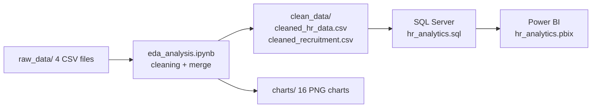
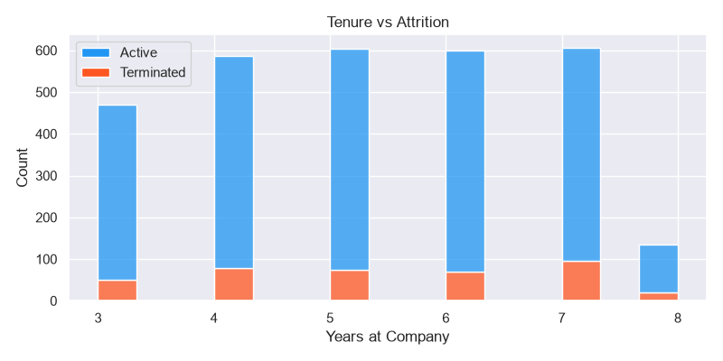
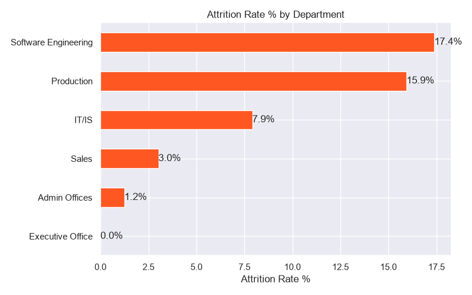
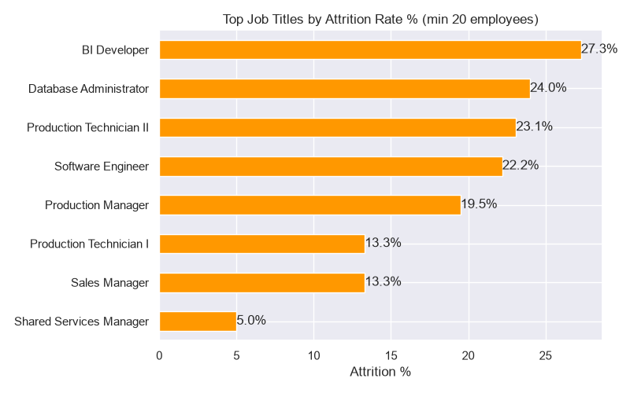
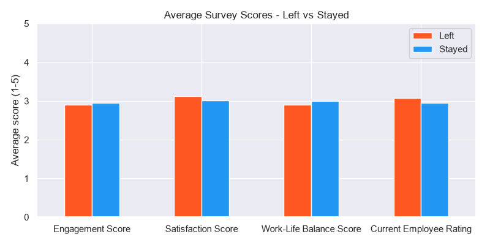
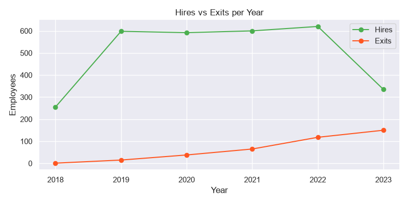
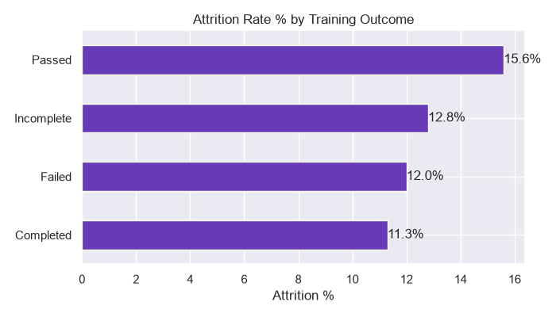

# 🏢 HR Workforce Analytics

[](https://github.com/Yasheekaa)
[](https://www.python.org/)
[](https://www.microsoft.com/sql-server)
[](https://powerbi.microsoft.com/)
[](./LICENSE)

An end-to-end HR analytics project where I clean and combine 4 HR datasets with **Python**, answer business questions with **SQL Server**, and build a 3-page **Power BI** dashboard. The main goal is to understand **who is leaving the company, when, and why**.

---

## 📌 Questions I wanted to answer

1. What is the overall attrition rate and which departments / job titles lose the most people?
2. In which year of service do employees leave the most?
3. Do engagement, satisfaction or work-life balance scores predict who will leave?
4. Does training outcome or training cost have any effect on attrition?
5. How does the recruitment pipeline look (status, education level, offer rate)?

---

## 🗃️ Dataset

Synthetic HR sample data from Kaggle (fictional company, used only for learning).

| File | Rows | What it contains |
| :--- | :---: | :--- |
| `raw_data/employee_data.csv` | 3,000 | Employee details: start / exit date, title, department, status, pay zone, gender, DOB, performance |
| `raw_data/employee_engagement_survey_data.csv` | 3,000 | Engagement, satisfaction and work-life balance scores (1 to 5) |
| `raw_data/training_and_development_data.csv` | 3,000 | Training program, type, outcome, duration and cost |
| `raw_data/recruitment_data.csv` | 3,000 | Job applicants: education, experience, desired salary, status |

The first three files are joined on the employee id (`EmpID` / `Employee ID`).

---

## 🛠️ Tools Used

| Tool | Used for |
| :--- | :--- |
| Python (pandas, numpy) | Cleaning, merging, feature creation |
| matplotlib, seaborn | EDA charts |
| scipy | t-test and chi-square test |
| SQL Server Express + SSMS | Business queries, CTEs, window functions, a view |
| Power BI + DAX | Interactive dashboard |

---

## 🔄 Workflow



---

## 🧹 Data Cleaning

- Removed extra spaces from text columns (`Production` had trailing spaces so it was grouped wrongly).
- Converted every date with its exact format (`20-Sep-19` for start / exit dates, `07-10-1969` for DOB).
- Created **`Attrition_Flag`** from `EmployeeStatus`: only *Voluntarily Terminated* and *Terminated for Cause* count as attrition.
- Calculated **Age** and **Tenure** using a fixed snapshot date (6 Aug 2023, the last date in the data). For leavers, tenure stops at their exit date.
- Created **Age_Group** (18-30 to 60+) and **Tenure_Band** (<1 yr to 4+ yrs).
- Merged employee + survey + training into one table (3,000 rows, 43 columns).
- Recruitment: converted dates, added applicant age and dropped phone / email / address columns.

### Mistakes I fixed in version 2

After finishing the first version I went back and reviewed my own work. These were the problems I found:

| Problem in v1 | Impact | Fix |
| :--- | :--- | :--- |
| Notebook used paths like `C:\Users\DELL\...` | Nobody else could run it | Relative paths from the `eda/` folder |
| Cleaned CSV was exported **before** the attrition flag was fixed | `Attrition_Flag` was 0 for every row in `cleaned_hr_data.csv` | Flag is created first, then exported |
| SQL table used a flag based on `TerminationType` | Dashboard showed 12.87% rate but "1K terminated" | One definition everywhere (`EmployeeStatus`) |
| Age bins stopped at 70 | 707 employees had no age group and were filtered out of the dashboard | New bins up to 60+ |
| Age and tenure calculated from today's date | Values changed on every run, leavers kept gaining tenure | Fixed snapshot date + exit date for leavers |
| README said low engagement and failed training lead to more exits | I had not actually tested this | Tested it (see insights below), both claims were wrong |
| `Offer Rate` DAX measure filtered `[State]` instead of `[Status]` | Always returned 0 | Corrected measure in [`dashboard/README.md`](dashboard/README.md) |

---

## 🚀 Key Insights

- **Attrition rate is 12.9%** (387 of 3,000 employees). Exits are growing every year: 15 in 2019, 118 in 2022 and already 150 by August 2023.
- **The first year is the riskiest.** 24.6% of employees with under 1 year of tenure left, compared to 2.9% for 4+ years.
- **Software Engineering (17.4%) and Production (15.9%)** have the highest department rates. Production alone has 83% of all leavers because it is the largest department.
- **Production Technician II** (23.1%) and **BI Developer** (27.3%) are the job titles with the highest attrition.
- Employees on a **PIP** leave the most (19.4% vs 10.8% for "Exceeds").
- **Survey scores do not explain attrition here.** Leavers and stayers have almost the same engagement (2.90 vs 2.95, t-test p = 0.55), satisfaction and work-life balance.
- **Training outcome is not significant** (chi-square p = 0.074). People who *passed* training actually left a bit more (15.6%).
- Recruitment offer rate is around 19% to 22% for every education level, and desired salary is about $65k for all of them.

**Suggestions:** focus on onboarding and the first 12 months, look into Production Technician II and the BI / software teams, follow up properly on PIPs, and use exit interviews since the engagement survey is not picking up who will leave.

---

## 📊 EDA Charts

| | |
| :---: | :---: |
|  |  |
|  |  |
|  |  |

All 16 charts are in the [`charts/`](charts) folder and are created by the notebook.

---

## 💡 SQL Highlights

[`sql/hr_analytics.sql`](sql/hr_analytics.sql) has data checks, 18 analysis queries and one view. Two examples:

**Attrition by tenure band**
```sql
SELECT
    Tenure_Band,
    COUNT(*) AS total_employees,
    SUM(Attrition_Flag) AS left_count,
    ROUND(SUM(Attrition_Flag) * 100.0 / COUNT(*), 2) AS attrition_rate_pct,
    ROUND(AVG(Tenure_Years), 2) AS avg_tenure_years
FROM hr_data
GROUP BY Tenure_Band
ORDER BY avg_tenure_years;
```

**Hires vs exits per year with a running total (CTE + window function)**
```sql
WITH hires AS (
    SELECT YEAR(StartDate) AS year_no, COUNT(*) AS hires
    FROM hr_data
    GROUP BY YEAR(StartDate)
),
exits AS (
    SELECT YEAR(ExitDate) AS year_no, COUNT(*) AS exits
    FROM hr_data
    WHERE Attrition_Flag = 1
    GROUP BY YEAR(ExitDate)
)
SELECT
    h.year_no,
    h.hires,
    COALESCE(e.exits, 0) AS exits,
    SUM(h.hires - COALESCE(e.exits, 0)) OVER (ORDER BY h.year_no) AS running_net_change
FROM hires h
LEFT JOIN exits e ON h.year_no = e.year_no
ORDER BY h.year_no;
```

---

## 📈 Power BI Dashboard

Three pages: **Workforce Overview**, **Attrition & Retention** and **Recruitment Pipeline**.
The DAX measures and the fixes from the review are documented in [`dashboard/README.md`](dashboard/README.md).

> The screenshots below are from version 1. Some attrition numbers in them (for example "1K terminated") came from the old flag and will match the notebook once the report is refreshed with the new data.

### Workforce Overview


### Attrition & Retention


### Recruitment Pipeline


---

## 🗂️ Project Structure

```text
HR-Workforce-Analytics/
├── raw_data/                  # original CSV files (4)
├── clean_data/
│   ├── cleaned_hr_data.csv    # employee + survey + training (3000 x 43)
│   └── cleaned_recruitment.csv
├── eda/
│   └── eda_analysis.ipynb     # cleaning, EDA, statistical tests, SQL upload
├── charts/                    # 16 charts saved by the notebook
├── sql/
│   └── hr_analytics.sql       # data checks + 18 queries + view (T-SQL)
├── dashboard/
│   ├── hr_analytics.pbix      # Power BI report
│   └── README.md              # DAX measures and dashboard fixes
├── screenshots/               # dashboard screenshots
├── requirements.txt
└── LICENSE
```

---

## ⚙️ How to Run

```bash
git clone https://github.com/Yasheekaa/HR-Workforce-Analytics.git
cd HR-Workforce-Analytics
pip install -r requirements.txt
cd eda
jupyter notebook eda_analysis.ipynb
```

1. Run all cells. The cleaned files and charts are created again in `clean_data/` and `charts/`.
2. **SQL (optional):** create a database called `hr_analytics` in SQL Server, set `LOAD_TO_SQL = True` in the last cell and run it. Then open `sql/hr_analytics.sql` in SSMS.
3. **Power BI:** open `dashboard/hr_analytics.pbix` and change the SQL Server name in *Transform data > Data source settings* if yours is different.

---

## 📚 What I Learned

- Always check *how* a column is filled before using it. `TerminationType` looked perfect for an attrition flag but it was filled for active employees too.
- The order of cells in a notebook matters. I exported the CSV before fixing the flag and did not notice until I checked the file.
- Rates are more useful than counts when groups have very different sizes.
- A chart can look like it proves something. Running a simple t-test / chi-square showed that two of my original claims were not true.

## 🔮 Next Steps

- Refresh the Power BI report with the fixed data and update the screenshots.
- Try a simple logistic regression to see which features predict attrition together.
- Add a monthly attrition trend page in the dashboard.

---

## 👩‍💻 Author

**Yashika Singh**
* GitHub: [@Yasheekaa](https://github.com/Yasheekaa)
* LinkedIn: [Yashika Singh](https://www.linkedin.com/in/yashika-singh-33983a329/)
* Email: [yashikasingh120104@gmail.com](mailto:yashikasingh120104@gmail.com)

## 📄 License

This project is licensed under the MIT License, see the [LICENSE](./LICENSE) file for details.
