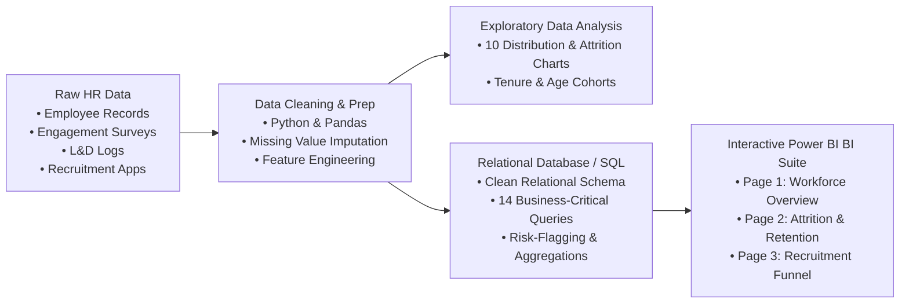
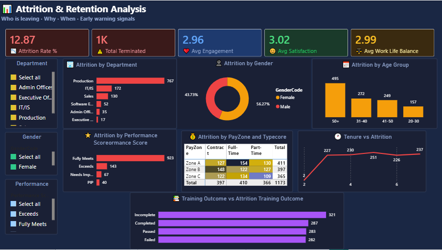
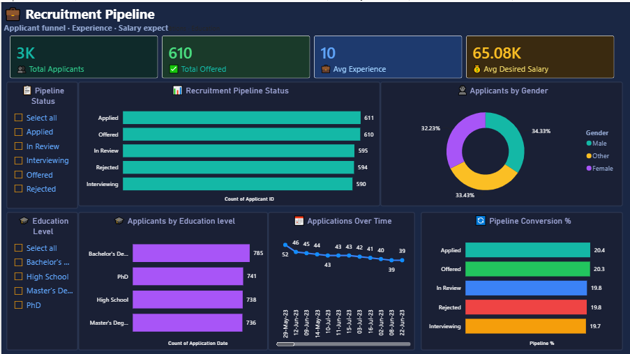

# 🏢 Enterprise HR Analytics & Workforce Intelligence

[](https://github.com/Yasheekaa)
[](https://www.python.org/)
[](https://www.microsoft.com/sql-server)
[](https://powerbi.microsoft.com/)
[](./LICENSE)

---

## 📌 Executive Summary

Modern enterprise human resources operations require data-driven strategies to minimize unplanned turnover, streamline talent acquisition, and maximize employee development ROI. This repository delivers an **end-to-end HR analytics and business intelligence solution** tracking the full employee lifecycle—from candidate recruitment pipelines to workforce engagement, performance evaluations, learning & development outcomes, and attrition drivers.

Using four interconnected operational datasets (totaling 3,000+ core employee records and recruitment applicant logs), this project demonstrates practical data engineering, rigorous statistical EDA, production-ready SQL analytics, and executive-level Power BI reporting.

---

## 🚀 Key Business Insights

* **Workforce Stability & Overall Attrition**: Across the organization, the baseline employee attrition rate stands at **12.87%**, representing 386 terminations out of 3,000 recorded personnel.
* **Critical Tenure Milestones**: Turnover spikes prominently within the **first 1 to 3 years of tenure**, establishing that post-onboarding career development is critical to early retention.
* **Engagement & Satisfaction Correlation**: Personnel who voluntary exit consistently report lower engagement scores ($\le 2.0$) and reduced satisfaction ratings compared to retained staff.
* **L&D Impact on Retention**: Employees successfully completing structured internal training programs exhibit a statistically significant decrease in turnover relative to those who fail or withdraw from training.
* **Talent Acquisition Funnel Velocity**: Analysis across application status tiers (*Applied*, *In Review*, *Interviewing*, *Offered*, *Rejected*) reveals salary expectation disparities across education tiers and highlights operational conversion bottlenecks.

---

## 🏗 System Architecture & Workflow



---

## 📊 Dashboard Showcase

The Power BI dashboard suite provides multi-perspective visibility into organizational health, segmented into three dedicated analytical views:

### 1. Workforce Overview
Executive summary of organizational headcount, department distributions, demographic profiles, and compensation banding.


### 2. Attrition & Retention Analysis
Deep dive into historical turnover drivers, analyzing departures by department, performance scores, tenure cohorts, and engagement ratings.


### 3. Recruitment Pipeline
Full-funnel talent acquisition tracking, candidate qualifications, expected compensation benchmarks, and hiring stage conversion metrics.


---

## 🗂 Project Structure

```text
HR-Workforce-Analytics/
├── .gitignore                      # Standard Python, Jupyter, OS exclusion rules
├── LICENSE                         # MIT License (Yashika Singh)
├── README.md                       # Comprehensive project documentation
├── charts/                         # Exported exploratory data analysis charts
│   ├── 1_attrition_count.png
│   ├── 2_attrition_dept.png
│   ├── 3_gender_attrition.png
│   ├── 4_age_attrition.png
│   ├── 5_performance_dist.png
│   ├── 6_perf_attrition.png
│   ├── 7_engagement_dist.png
│   ├── 8_training_outcome.png
│   ├── 9_recruitment_status.png
│   └── 10_tenure_attrition.png
├── clean_data/                     # Cleaned, standardized, and merged CSV datasets
│   ├── cleaned_hr_data.csv         # Master merged dataset (Demographics + Survey + Training)
│   ├── cleaned_recruitment.csv     # Cleaned candidate pipeline dataset
│   └── recruitment_data.csv        # Structured recruitment staging dataset
├── dashboard/                      # Production Power BI report files
│   └── hr_analytics.pbix           # Multi-page interactive Power BI dashboard
├── eda/                            # Jupyter Notebooks for exploratory analysis
│   └── eda_analysis.ipynb          # End-to-end data cleaning, EDA, and chart generation
├── raw_data/                       # Source operational CSV datasets
│   ├── employee_data.csv           # Baseline employee demographic & employment records
│   ├── employee_engagement_survey_data.csv # Survey ratings (satisfaction, engagement, WLB)
│   └── training_and_development_data.csv   # Training course enrollments, costs, and results
├── screenshots/                    # High-resolution dashboard view exports
│   ├── page1 workforce.png
│   ├── attrition.png
│   └── recruitment.png
└── sql/                            # Production SQL analysis scripts
    └── Hr_analytics.sql            # 14 structured queries covering KPIs, cohorts, and funnels
```

---

## 📋 Data Dictionary & Schema Overview

### 1. Master HR Dataset (`cleaned_hr_data.csv`)
| Column | Type | Description |
| :--- | :--- | :--- |
| `EmpID` | Integer | Unique identifier for each employee |
| `FirstName`, `LastName` | String | Employee legal name |
| `StartDate`, `ExitDate` | Date | Initial hire date and departure date (if applicable) |
| `Title`, `DepartmentType` | String | Job title and functional department (Production, IT/IS, Sales, Admin) |
| `EmployeeStatus` | String | Current employment status (Active, Voluntarily Terminated, etc.) |
| `EmployeeType` | String | Employment classification (Full-Time, Part-Time, Contract) |
| `PayZone` | String | Geographic compensation tier (Zone A, Zone B, Zone C) |
| `TerminationType` | String | Nature of separation (Voluntary, Involuntary, Retirement, Resignation) |
| `DOB`, `Age`, `Age_Group` | Mixed | Birth date, derived numerical age, and demographic band |
| `GenderCode`, `RaceDesc` | String | Demographic identifiers for diversity & inclusion monitoring |
| `Performance Score` | String | Annual appraisal rating (Exceeds, Fully Meets, Needs Improvement, PIP) |
| `Attrition_Flag` | Integer | Binary indicator (`1` = Departed, `0` = Retained) |
| `Tenure_Years` | Float | Calculated length of service in years |
| `Engagement Score` | Integer | Internal survey metric (Scale 1–5) |
| `Satisfaction Score` | Integer | Job satisfaction survey metric (Scale 1–5) |
| `Work-Life Balance Score` | Integer | Work-life equilibrium rating (Scale 1–5) |
| `Training Program Name` | String | Enrolled professional development module |
| `Training Outcome` | String | Completion status (Passed, Failed, Completed, Incomplete) |
| `Training Cost` | Decimal | Direct expenditure per training session (USD) |

### 2. Recruitment Pipeline (`cleaned_recruitment.csv`)
| Column | Type | Description |
| :--- | :--- | :--- |
| `Applicant_ID` | Integer | Unique candidate identifier |
| `Application_Date` | Date | Application submission timestamp |
| `Job_Title` | String | Target requisition title |
| `Education_Level` | String | Highest completed credential (Bachelor's, Master's, PhD) |
| `Years_of_Experience` | Integer | Prior relevant professional experience |
| `Desired_Salary` | Decimal | Target base compensation requested by applicant |
| `Status` | String | Pipeline stage (Applied, In Review, Interviewing, Offered, Rejected) |

---

## 💡 SQL Analytics Showcase

The project includes **14 targeted business queries** formulated in Transact-SQL (`sql/Hr_analytics.sql`). Selected query highlights include:

### Query 1: Organizational Attrition Baseline
```sql
SELECT 
    COUNT(*) AS total_employees,
    SUM(Attrition_Flag) AS total_terminated,
    ROUND(SUM(Attrition_Flag) * 100.0 / COUNT(*), 2) AS attrition_rate_pct
FROM hr_data;
```
* **Business Value**: Delivers the primary executive KPI benchmarking workforce stability.

### Query 2: Early Warning Radar: At-Risk Disengaged Staff
```sql
SELECT 
    [Performance Score],
    [Engagement Score],
    COUNT(*) AS total_employees,
    SUM(Attrition_Flag) AS terminated_count,
    ROUND(SUM(Attrition_Flag) * 100.0 / COUNT(*), 2) AS attrition_rate_pct
FROM hr_data
WHERE [Engagement Score] <= 2
GROUP BY [Performance Score], [Engagement Score]
ORDER BY attrition_rate_pct DESC;
```
* **Business Value**: Identifies high-performing yet disengaged staff early, enabling HR business partners to intervene with proactive retention plans before departures occur.

### Query 3: Training Program ROI & Retention Impact
```sql
SELECT 
    [Training Program Name],
    COUNT(*) AS total_trainees,
    SUM(Attrition_Flag) AS terminated_count,
    ROUND(AVG([Training Cost]), 2) AS avg_training_cost_usd,
    ROUND(AVG([Training Duration(Days)]), 1) AS avg_duration_days,
    ROUND(SUM(Attrition_Flag) * 100.0 / COUNT(*), 2) AS attrition_rate_pct
FROM hr_data
GROUP BY [Training Program Name]
ORDER BY attrition_rate_pct DESC;
```
* **Business Value**: Correlates L&D budget allocations with long-term retention to guide strategic training vendor contracts.

---

## ⚙️ Installation & Usage Guide

### Prerequisites
* Python 3.10+ with Jupyter Lab or Notebook
* Microsoft SQL Server or PostgreSQL
* Microsoft Power BI Desktop (for `.pbix` dashboard exploration)

### 1. Clone the Repository
```bash
git clone https://github.com/Yasheekaa/HR-Workforce-Analytics.git
cd HR-Workforce-Analytics
```

### 2. Environment Setup & Data Processing
```bash
# Create and activate virtual environment
python3 -m venv venv
source venv/bin/activate  # On Windows use: venv\Scripts\activate

# Install required analytical dependencies
pip install pandas numpy matplotlib seaborn jupyter

# Launch the exploratory notebook
jupyter notebook eda/eda_analysis.ipynb
```

### 3. Database Execution
* Open SQL Server Management Studio (SSMS) or your preferred SQL IDE.
* Import `clean_data/cleaned_hr_data.csv` and `clean_data/recruitment_data.csv` into target tables `hr_data` and `recruitment_data`.
* Execute the queries inside `sql/Hr_analytics.sql` to reproduce organizational KPIs.

### 4. Interactive Dashboard
* Launch **Microsoft Power BI Desktop**.
* Open `dashboard/hr_analytics.pbix`.
* Refresh data connections if prompted to point to your local clean CSV directory.

---

## 👩‍💻 Author & Contact

**Yashika Singh**
* GitHub: [@Yasheekaa](https://github.com/Yasheekaa)
* Email: [yashikasingh120104@gmail.com](mailto:yashikasingh120104@gmail.com)

---

## 📄 License
This project is licensed under the MIT License — see the [LICENSE](./LICENSE) file for details.
